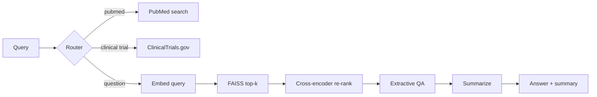

# Auto-Med-Agent

Medical research assistant. Ask questions over medical papers (RAG), search PubMed, or find clinical trials, all from one Streamlit chat.

<p>
  
  
  
  
</p>

## What it does

| Query | Example | Handled by |
|---|---|---|
| Medical question | `What are the symptoms of SARS-CoV-2?` | RAG over your papers |
| `pubmed <topic>` | `pubmed COVID-19 treatment` | PubMed E-utilities API |
| `clinical trial <condition>` | `clinical trial lung cancer` | ClinicalTrials.gov API |

Upload new papers (.txt or .pdf) in the app and rebuild the index.

## How it works



| Step | Model |
|---|---|
| Embeddings | `sentence-transformers/all-mpnet-base-v2` |
| Re-ranking | `cross-encoder/ms-marco-MiniLM-L-6-v2` |
| Answer extraction | `deepset/roberta-base-squad2` |
| Summary | `facebook/bart-large-cnn` |
| Eval questions | `valhalla/t5-base-qg-hl` |

Evaluation: T5 generates Q&A pairs from the papers (`data/generated_qas.json`), then the agent's answers are scored with ROUGE and BLEU.

## Run it

```bash
git clone https://github.com/mohamed-halemo/Auto-Med-Agent.git
cd Auto-Med-Agent
pip install -r requirements.txt
streamlit run app.py
```

Models download from Hugging Face on first run (~2 GB). No API keys needed.

Other scripts:

```bash
python retriever/build_faiss.py        # rebuild the index from data/pubmed_papers/
python qa_generator/generate_qas.py    # generate eval Q&A pairs
```

## Structure

```
app.py                     Streamlit UI
agents/tool_agent.py       routes the query to a tool or RAG
agents/literature_agent.py retrieval, re-ranking, QA, summary
tools/toolkit.py           PubMed + ClinicalTrials.gov search
retriever/build_faiss.py   chunk + embed + build FAISS index
qa_generator/              T5 question generation
evaluation/                ROUGE + BLEU
data/pubmed_papers/        sample papers (breast cancer, COVID-19, diabetes)
```

## Limitations

- The sample corpus is small (3 papers). Add your own to make it useful.
- Answers are extractive spans, not generated text.
- Research and learning project. Not medical advice.
